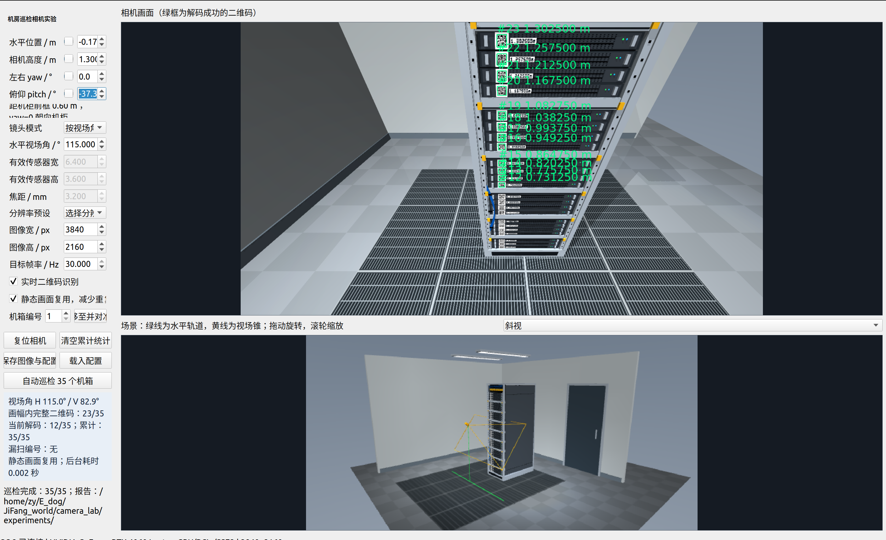
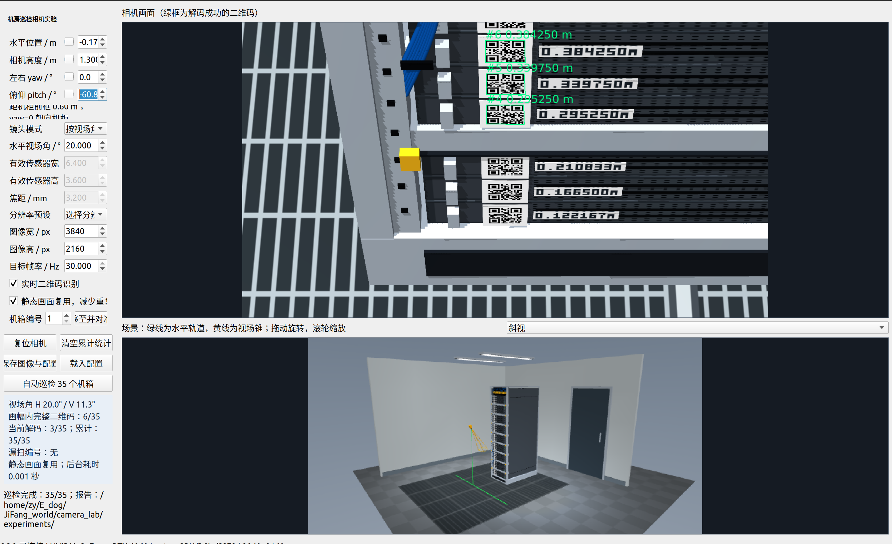
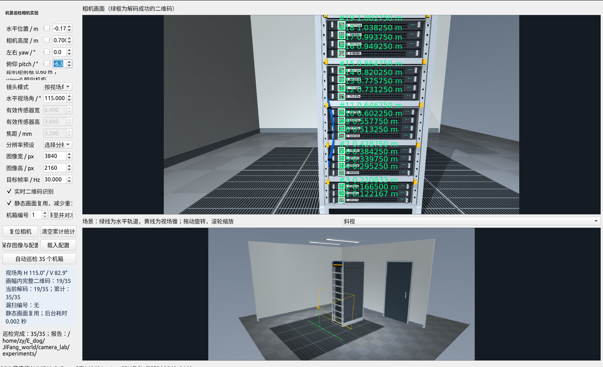

# 相机最低安装高度论证

**结论：建议优先将相机机构最低高度由 1.3 m 下调至约 0.7 m，再开展相机选型。现有截图足以支持这一结构调整方向，但尚不属于实机识别成功率验证。**

## 论证目标

现有机构的相机高度范围为 **1.3–1.8 m**。上部二维码可通过抬升相机观察，本次只关注**最底部二维码是否清晰、能否解码**，不以整柜或累计识别数量作为判据。

最底部三个二维码中心距地面分别约为 **0.122、0.167、0.211 m**。三组截图均采用 3840×2160 分辨率，距机柜前框约 0.60 m，水平位置和 yaw 相同；视场角与俯仰角按各方案调整。

## 图片对比

| 工况 | 水平视场角 | 界面 pitch | 最底部二维码表现 |
| --- | ---: | ---: | --- |
| 高度 1.3 m，广角 | 115° | −37.3° | 底部码在图像中较小且受透视压缩，最底部三个码均未显示解码成功标记。 |
| 高度 1.3 m，窄视场 | 20° | −60.8° | 底部码已明显放大，但沿竖直方向压缩严重，最底部三个码仍未解码；图中成功标记位于更高的约 0.295–0.384 m 处。 |
| 高度 0.7 m，广角 | 115° | −6.3° | 最底部三个码均显示绿色解码标记，读出的高度分别为 0.122167、0.166500、0.210833 m。 |

注：负 pitch 表示向下俯拍；“约 60°俯拍”对应截图中的 pitch≈−60.8°。截图中的“累计 35/35”不用于本次判断。

### 图 1：1.3 m，115°水平视场角

### 图 2：1.3 m，20°水平视场角，约 60°俯拍

### 图 3：0.7 m，115°水平视场角

## 判断依据

**当前的主要约束是高安装位置造成的斜视几何，而不仅是二维码像素不足。** 在 1.3 m 高度下，将水平视场角从 115°缩小到 20°，已经放大了底部二维码，但最底部三个码仍未解码。因此，仅靠更换焦距或视场角，在这组实验中没有解决最低位扫码问题。

降低相机位置可以直接改善观察几何。按当前模型相机至二维码平面的水平距离约 0.612 m 计算，对最底部 0.122 m 处的二维码：

- 相机高度 1.3 m 时，视线与二维码正面法线的夹角约 **62.5°**；
- 相机高度 0.7 m 时，该夹角约 **43.4°**。

相机降低后，斜视程度和拍摄距离均减小，与截图中底部码恢复解码的现象一致。这里的图像变形主要是**透视压缩与梯形变形**；调整 pitch 可以把目标移入画面中心，但不能消除安装位置造成的斜视角。

当前仿真采用理想针孔成像，尚未叠加实机的失焦、运动模糊、噪声、曝光和反光等不利因素。**在理想条件下仍无法解码的 1.3 m 大俯角方案，实机可靠性风险较高，不宜作为最低位扫码的设计保证。** 0.7 m 方案已有正向仿真证据，但实机效果仍需复核。

## 建议汇报口径

> 仿真对比表明，现有 1.3 m 最低安装高度在观察柜底二维码时，需要约 60°的大角度俯拍，图像出现明显透视压缩。即使缩小视场角、放大二维码，最底部三个码仍无法解码；将相机降至约 0.7 m 后，同样使用 4K 分辨率，115°广角画面已能读出最底部三个码。因此，建议优先扩展机构向下行程，再优化镜头参数；仅更换相机或镜头并非当前问题的优先解决路径。实际成像还存在额外退化因素，后续应针对最底部三个码进行实机验证。

**结论边界：** 当前证据支持“优先降低最低安装高度”，不等同于证明所有相机在 1.3 m 均无法扫码，也未证明 0.7 m 是唯一或最优高度。后续只需围绕最底部三个码，核验 0.7 m 附近的可用安装范围及实际识别稳定性。
